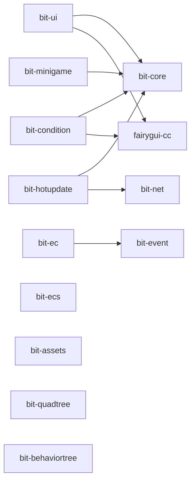

# Bit Framework 架构设计

## 架构总览

基于 **mise tasks + pnpm workspace** 的游戏框架集合，专为 Cocos Creator 3.x 设计。12 个框架模块与 FairyGUI 子模块中的 npm 包共用同一版本，由主仓库统一全量发布。

```
bit-framework/
├── bit-core/            # 核心工具（Time, Platform, Timer, Utils）
├── bit-ui/              # FairyGUI UI 管理（窗口、装饰器）
├── bit-ecs/             # 高性能 ECS 架构
├── bit-ec/              # Cocos 适配 EC 架构
├── bit-event/           # 全局事件系统
├── bit-net/             # HTTP + WebSocket
├── bit-assets/          # 资源加载管理
├── bit-quadtree/        # 四叉树碰撞检测
├── bit-behaviortree/    # AI 行为树
├── bit-condition/       # UI 条件显示（红点）
├── bit-minigame/        # 小游戏平台适配
├── bit-hotupdate/       # 热更新系统
└── vendor/fairygui-cc/  # FairyGUI fork（git submodule，@gongxh/fairygui-cc）
```

## 模块依赖关系



| 模块 | 依赖（均为 peer，由消费方安装，保证单实例） |
|------|------|
| bit-core | 无 |
| bit-event / bit-ecs / bit-net / bit-assets / bit-quadtree / bit-behaviortree | 无 |
| bit-ui / bit-condition | bit-core + fairygui-cc |
| bit-minigame | bit-core |
| bit-ec | bit-event |
| bit-hotupdate | bit-core + bit-net |

公开包之间的依赖在源码中使用 `workspace:*`，npm 包中的依赖和 peer 依赖精确指向本批次统一版本。消费项目中的框架包和 `@gongxh/fairygui-cc` 应同步升级。

## 技术栈

| 技术 | 版本 | 用途 |
|------|------|------|
| TypeScript | 5.x | 开发语言 |
| mise | 2026.9+ | 工具版本与任务管理 |
| pnpm | 10.x | mise 管理的包管理器 + workspace |
| Rollup | 4.x | 构建打包 |
| Cocos Creator | 3.7.0+ | 游戏引擎 |
| FairyGUI | 1.2.2 | UI 编辑器（bit-ui 使用） |

## 构建输出

每个 bit 模块的 `dist/` 目录生成：

```
bit-xxx.mjs / .cjs          # ESM / CommonJS（未压缩）
bit-xxx.min.mjs / .min.cjs  # ESM / CommonJS（压缩，生产用）
bit-xxx.d.ts                # TypeScript 类型定义
```

bit 模块共用 `rollup.config.base.mjs`。FairyGUI 使用 `source/gulpfile.js` 生成 `source/dist/fairygui.mjs`、`fairygui.min.mjs` 和 `fairygui.d.ts`，这些产物由子仓库跟踪。

`mise run build` 按 workspace 依赖顺序构建全部公开包。

## 统一发布

项目的 mise task 为 `setup`、`build`、`changeset`、`publish`。`setup` 安装固定工具、按主仓库 gitlink 同步子模块并安装 workspace 依赖；`changeset` 是可选的独立变更记录入口。所有公开包属于同一固定版本组，以本批次最高变更级别更新全部版本。

`publish` 自动检查发布分支，通过 Git 原生 `merge --ff-only --autostash` 携带已跟踪的本地修改进行仅快进同步。主仓库同步后，先使子模块包含主仓库 gitlink，再同步 `ccc3.0`，全部源码同步后全量构建并复用或交互生成 Changeset。规划和打包检查成功后，先提交推送 FairyGUI 的全部可提交修改到 `ccc3.0`，再提交推送主仓库全部可提交修改和 gitlink 到 `main`；范围包含已暂存、未暂存和未被 Git 忽略的未跟踪文件。分叉、自动恢复冲突或未跟踪文件覆盖保护等无法安全同步时停止并保留现场，可通过 `git status`、`git stash list` 检查恢复。

本地准备完成后，通过 GitHub CLI 调度主仓库手动发布工作流并等待结果。CI 全量构建后消费 Changeset，生成统一版本、包级 CHANGELOG 和锁文件，将 FairyGUI 版本提交推到子仓库专用发布分支，再把记录该 gitlink 的主仓库版本提交推到 `main`。

准备运行冻结主仓库版本提交，确保子仓库 `ccc3.0` 包含本批次 gitlink，必要时快进；已包含该提交的后代分支保持原位，真正分叉时停止，发布源码仍固定为本批次 gitlink。pending 引用固定发布提交，失败后恢复同一批次，完成前阻止生成下一版本。准备运行返回 `prepared` 后，本地入口核验 pending 引用并从该引用启动新的发布运行；上传时 GitHub 事件 SHA 必须与冻结 HEAD 一致，保留原始 `GITHUB_SHA`，使 OIDC 与 npm provenance 的来源一致。所有 npm 包先上传到 `release-candidate`，全部校验后提升到 `latest`，最后在两个仓库创建相同的 `vX.Y.Z` tag。具体命令与凭证见 [COMMANDS.md](./COMMANDS.md)。

本地 `publish` 本次准备了新版本且先完成旧 pending 时，确认远端 `main` 仍为本次队列提交后，再处理目标版本。每批最多一次准备运行和一次发布运行，总共最多两批、四次运行；每次请求标识唯一，不重复准备本地源码。只有本次目标版本完成才返回成功；来源或冻结引用变化、运行失败、结果与准备清单不一致时报告未完成。从 GitHub 页面单独手动调度一次只运行一次 CI，返回 `prepared` 时需从 pending 引用继续调度。

## TypeScript 约定

```json
{
  "experimentalDecorators": true,  // 装饰器广泛使用
  "strictNullChecks": false,        // Cocos Creator 兼容性
  "declaration": true               // 生成 .d.ts
}
```

## 装饰器模式

| 模块 | 装饰器 | 用途 |
|------|--------|------|
| bit-ui | `@_uidecorator.uiclass` `@_uidecorator.uiprop` `@_uidecorator.uiclick` | UI 窗口注册 |
| bit-ecs | `@_ecsdecorator.ecsclass` `@_ecsdecorator.ecsprop` `@_ecsdecorator.ecsystem` | ECS 组件/系统 |
| bit-ec | `@_ecdecorator.ecclass` `@_ecdecorator.ecprop` | EC 组件 |
| bit-condition | `@_conditionDecorator.conditionClass` | 条件类注册 |
| bit-behaviortree | `@ClassAction` `@prop` | 行为树节点 |

## 设计原则

1. **单向依赖** — 禁止循环依赖，双向通信通过 bit-event
2. **依赖最小** — 仅引入各模块声明的引擎和 peer 依赖
3. **类型安全** — 优先使用精确类型，避免不必要的 `any` 断言，并完整导出公共类型
4. **性能优先** — 使用对象池减少 GC，密集数据结构
5. **可扩展** — 抽象类 + 接口 + 生命周期钩子

## 新增模块规范

```
bit-xxx/
├── src/index.ts       # 导出所有公开 API
├── dist/              # 构建产物（git 忽略）
├── package.json       # name: @gongxh/bit-xxx
├── tsconfig.json      # 继承根配置
├── rollup.config.mjs  # 引用 rollup.config.base.mjs
└── README.md
```

添加到 `pnpm-workspace.yaml`，设置与现有公开包相同的版本，并使用 `workspace:*` 声明内部依赖。新增公开包自动进入统一版本组、构建和发布清单；同时为该包配置主仓库 workflow 的 npm trusted publisher。
